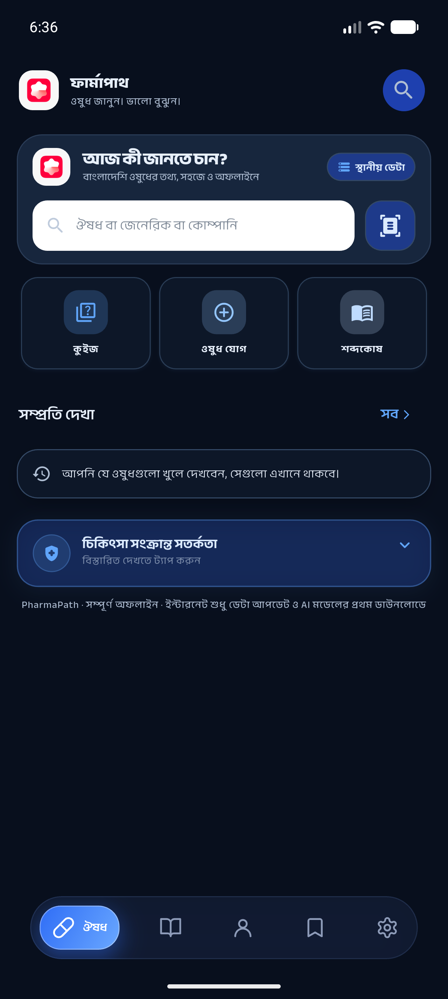
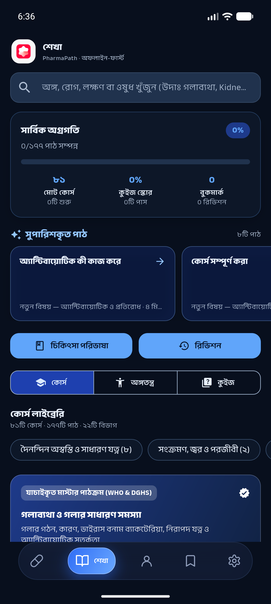
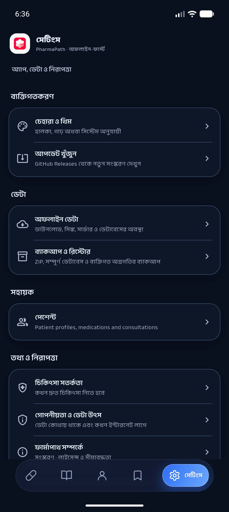

# PharmaPath — Flutter medicine catalogue client

## GitHub releases and in-app Android updates

The app checks the latest **published, non-prerelease** GitHub Release at startup and from **Settings → আপডেট খুঁজুন**. When an update is newer than the installed version, Android downloads the release APK and opens Android's package installer. Android still asks the user to confirm installation. On other platforms, the update prompt links to the release page. The mandatory startup check requires an internet connection so GitHub can confirm there is no newer build.

The production GitHub repository is `shahinrezasifat/pharmapath-app`. The automated release workflow sets its owner and name. Local builds can set these values explicitly:

```powershell
flutter build apk --release `
  --dart-define=GITHUB_REPOSITORY_OWNER=shahinrezasifat `
  --dart-define=GITHUB_REPOSITORY_NAME=pharmapath-app
```

The generated universal APK is `build/app/outputs/flutter-apk/app-release.apk`. Publish it as an asset on a GitHub Release whose tag matches the app version (for example `v2.0.0`). Every future release must increment `version:` in `pubspec.yaml`, use the same Android application ID and signing key, attach an `.apk` asset, and use a version tag greater than the installed version. Android will reject an APK signed with a different key or with a non-incremented version code. Do not publish the debug APK.

To publish tagged builds automatically, push `.github/workflows/android-release.yml` to the repository, then push a version tag such as `v2.0.0`. The workflow builds the APK using the actual GitHub owner/repository values and attaches it to a GitHub Release. For upgrade compatibility, add `ANDROID_KEYSTORE_BASE64` (the base64 encoded signing keystore) and `ANDROID_KEY_PROPERTIES` (the four `key.properties` lines, with `storeFile=android/pharmapath-release.keystore`) as repository Actions secrets before publishing. Existing local key files are intentionally excluded from Git. Keep the signing key and package ID stable across upgrades; without these secrets, the workflow creates a debug-signed APK for first installs, which cannot update an APK signed with a different key.

### Screenshots

GitHub Actions captures real home, learning, and settings screens on an Android emulator and attaches them to each GitHub Release.

PharmaPath is a Flutter client for the medicine-catalogue HTTP API that was
documented during the static reverse-engineering study of the shipped MedEx
3.5.0 Android application. The study lives one directory up in
`../MedEx-Reverse-Engineering/`.

The app is **read-only**: it fetches catalogue records and lets you browse,
search and locally bookmark them. Favourites and history never leave the
device.

---

## 1. Project layout

```
pharmapath_app/
├── lib/
│   ├── main.dart                  # bootstrap, GetX DI, MaterialApp
│   ├── app/
│   │   ├── routes.dart            # route constants + icon mapping
│   │   └── theme.dart             # Material 3 light/dark themes
│   ├── core/
│   │   ├── app_config.dart        # compile-time defaults, timeouts
│   │   ├── api_client.dart        # HTTP GET, URL building, bearer token
│   │   ├── api_exception.dart     # typed error with status/URI
│   │   ├── json_utils.dart        # tolerant envelope/list parsing
│   │   ├── paged_result.dart      # generic page wrapper
│   │   ├── demo_data.dart         # offline fixture catalogue
│   │   └── storage.dart           # get_storage keys
│   ├── models/
│   │   ├── catalog_item.dart      # resource-agnostic record + field aliases
│   │   └── catalog_resource.dart  # recovered endpoints
│   ├── repositories/
│   │   └── catalog_repository.dart# live + demo data access
│   ├── controllers/               # GetX state (settings, lists, search…)
│   ├── views/                     # screens
│   └── widgets/                   # cards, rails, states, HTML renderer
├── test/widget_test.dart          # parser unit tests
└── pubspec.yaml
```

State management is **GetX**; the HTTP layer is `package:http`; local storage is
`get_storage`; rich text is rendered with `flutter_widget_from_html_core`.

---

## 2. API configuration

| Setting | Default | Where to change |
|---|---|---|
| Base URL | `https://medex.com.bd/api/beta/` | Settings → Connection, or `--dart-define=MEDEX_API_BASE=…` |
| Bearer token | empty | Settings → Connection, or `--dart-define=MEDEX_API_TOKEN=…` |
| Live API on start | `true` | `--dart-define=ENABLE_LIVE_API=false` |
| Offline demo mode | off | Settings → Connection toggle |

The base URL is the one literal string recovered from the MedEx Dart AOT
snapshot. Endpoint paths below are the fragments that survived in the binary;
**HTTP semantics and detail-path templates are inferred**, because the Dart
controller code is compiled machine code and was not decompiled.

### Resources wired into the UI

| Resource | Path | Notes |
|---|---|---|
| Global search | `search?search=` (+ optional `type`) | typed search |
| Brands | `brands` | supports `page`, `alpha`, `type` |
| Generics | `generics` | `type=herbal`, `type=veterinary` |
| Companies | `companies` | supports `alpha` |
| Dosage forms | `dosage-forms` | |
| Drug classes | `drug-classes` | |
| Indications | `indications` | supports `search` |
| Jobs | `jobs` | path inferred |
| Newly launched | `newly-launched-brands` | |
| Featured brands | `special-segments/brands` | |
| Campaigns | `campaigns` | home rail |
| Segments | `segments` | home data |
| Privacy / terms | `privacy` / `terms` | text rendered in-app |

Detail screens request `<detailBase>/<id>` (e.g. `brands/42`). If that request
fails, the list record already in memory is shown instead, so navigation never
dead-ends.

Because the response schema is undocumented, `json_utils.dart` accepts:

* a bare JSON list,
* `{ "data": [ … ] }`,
* `{ "data": { "data": [ … ], "current_page": …, "last_page": … } }`,
* named lists such as `brands`, `generics`, `companies`, …

Pagination metadata (`current_page`, `last_page`, `total`, `next_page_url`) is
read opportunistically; when it is missing, the client falls back to
"a full page means there may be more".

### Authentication — read this first

The API is **not anonymous**. A live request without a token returns HTTP 200
with an application-level failure:

```json
{"success": false, "message": "Authentication token missing", "data": []}
```

The transport is a standard bearer header: sending
`Authorization: Bearer <token>` changes the response to
`{"success": false, "message": "Invalid token [IT900]", "data": []}` for a bad
token, which confirms the header name. The original application obtains its
token through its own account/OTP login flow; that flow is **not** implemented
here and this project does **not** bypass it.

So to use live data you must supply a token you are authorized to use:

1. Open **Settings → Connection**.
2. Paste the token (it is stored locally with `get_storage`).
3. Tap **Test** — it should report `OK · N items`.
4. Tap **Save**, then retry the catalogue screen.

Without a token the app now shows the server's message plus a shortcut to the
connection settings, instead of pretending the catalogue is empty. If you only
want to explore the interface, enable **Offline demo data**; no request is made
in that mode.

The token is never logged, bundled, or written to the reverse-engineering
reports.

### Ignored integrations
The original application also contained an ACI ordering flow over cleartext
HTTP (`http://apps.acibd.com/apps/myaci/…`) and Firebase/AdMob keys. Those were
**deliberately not implemented**: PharmaPath performs no authentication, no
ordering, and ships no third-party keys.

---

## 3. Screens

* **Home** — search launcher, campaign rail, category grid, newly launched and
  featured brand rails.
* **Browse** — every recovered resource plus legal/about entries.
* **Search** — debounced global search with type filter chips and recent
  searches.
* **Catalogue list** — paginated list, A–Z filter for brands/companies,
  pull-to-refresh, infinite scroll with manual fallback.
* **Detail** — hero image, mapped fields, HTML description, favourite toggle,
  technical JSON panel in debug builds.
* **Saved / History** — local-only lists with per-item and bulk clearing.
* **Settings** — base URL, bearer token, connectivity probe, demo toggle, dark
  theme, local data management.

All list/detail/error states have explicit loading, empty, partial-failure and
retry UI.

---

## 4. Running

```bash
cd /home/sifat/Desktop/PharmaPath/pharmapath_app
flutter pub get
flutter run                 # pick a connected device
flutter run -d chrome       # web
```

Useful overrides:

```bash
flutter run --dart-define=MEDEX_API_BASE=https://example.test/api/beta/ \
            --dart-define=MEDEX_API_TOKEN=your-own-token
```

Demo mode (no network at all):

```bash
flutter run --dart-define=ENABLE_LIVE_API=false
```

Checks:

```bash
flutter analyze     # currently clean
flutter test        # parser/model unit tests
flutter build web   # verified
```

---

## 5. Legal / ethical note

The endpoint list is documentation of what a shipped binary contains; it is not
a grant of access. Point this client only at an API you operate or are
explicitly authorized to use, respect its terms and rate limits, and do not use
it to redistribute third-party catalogue data. No credentials, API keys or
certificates recovered during the study are included in this repository.

## Screenshots

### Home


### Learning


### Settings

