<div align="center">
  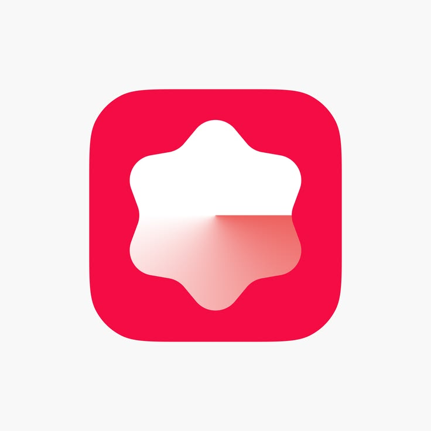
  <h1>PharmaPath</h1>
  <p><strong>ওষুধ জানুন। ভালো বুঝুন।</strong></p>
  <p>বাংলাদেশি ওষুধের তথ্য, ফার্মেসি শেখা ও রোগীর সহায়তার অফলাইন-ফার্স্ট Android অ্যাপ</p>
  <p>
    <a href="https://github.com/shahinrezasifat/pharmapath-app/releases/latest"></a>
    <a href="https://github.com/shahinrezasifat/pharmapath-app/releases/latest"></a>
    
  </p>
  <p><a href="https://github.com/shahinrezasifat/pharmapath-app/releases/latest"><strong>⬇ সর্বশেষ APK ডাউনলোড</strong></a> · <a href="#screenshots">স্ক্রিনশট দেখুন</a> · <a href="#features">ফিচার</a></p>
</div>

> **চিকিৎসা-সংক্রান্ত সতর্কতা:** PharmaPath-এর ওষুধ ও শেখার তথ্য শিক্ষামূলক; এগুলো চিকিৎসকের পরামর্শ, রোগ নির্ণয় বা প্রেসক্রিপশনের বিকল্প নয়। ওষুধ শুরু, বন্ধ বা ডোজ বদলানোর আগে যোগ্য চিকিৎসক বা ফার্মাসিস্টের পরামর্শ নিন। জরুরি উপসর্গে দ্রুত চিকিৎসা নিন।

## PharmaPath সম্পর্কে

PharmaPath একটি বাংলা-প্রথম Android অ্যাপ। স্থানীয়ভাবে সংরক্ষিত ওষুধের ক্যাটালগ, শেখার পাঠ এবং আপনার সেভ করা তথ্য ইন্টারনেট ছাড়াই দেখা যায়। ইন্টারনেট থাকলে ক্যাটালগ সিঙ্ক, ঐচ্ছিক AI সহায়তা এবং GitHub থেকে নতুন সংস্করণ যাচাই করা যায়। অ্যাকাউন্ট বা সাবস্ক্রিপশন লাগে না।

<a id="features"></a>
## অ্যাপের ফিচার

| বিভাগ | কী পাবেন |
|---|---|
| 💊 ওষুধ | জেনেরিক, ব্র্যান্ড ও কোম্পানি দিয়ে খোঁজা; ওষুধের বিবরণ, বিকল্প এবং পছন্দের তালিকা |
| 📚 শেখা | বাংলা কোর্স, পাঠ, শারীরস্থান, চিকিৎসা পরিভাষা, কুইজ ও রিভিশন |
| 🧑‍⚕️ রোগী | ডিভাইসেই রোগীর প্রোফাইল, ওষুধের তালিকা ও পরামর্শ-সংক্রান্ত নোট |
| ✨ সহায়তা | ঐচ্ছিক বাংলা ও ইংরেজি AI সহায়তা; উত্তর ভুল হতে পারে |
| 💾 ডেটা | অফলাইন ক্যাটালগ, স্থানীয় ইতিহাস এবং ZIP/ডেটাবেস ব্যাকআপ ও রিস্টোর |
| 🎨 ব্যক্তিগতকরণ | হালকা, গাঢ় বা সিস্টেম থিম; বাংলা ইন্টারফেস |
| 🔄 আপডেট | চালুর সময় নতুন GitHub Release যাচাই; আপডেট থাকলে ইনস্টল না করা পর্যন্ত মূল অ্যাপ খোলা যায় না |

<a id="screenshots"></a>
## স্ক্রিনশট

নিচের ছবিগুলো Android এমুলেটর থেকে অ্যাপের বর্তমান বিল্ডে নতুন করে নেওয়া। প্রতিটি ছবিতে ক্লিক করলে পূর্ণ আকারে দেখা যাবে।

### মূল পর্দা ও ন্যাভিগেশন

<table>
  <tr>
    <td align="center"><a href="docs/app/screenshots/home.png"></a><br><strong>হোম</strong></td>
    <td align="center"><a href="docs/app/screenshots/search.png">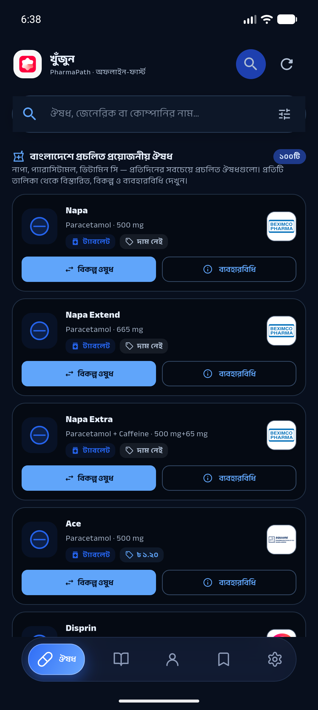</a><br><strong>ওষুধ খোঁজা</strong></td>
    <td align="center"><a href="docs/app/screenshots/medicine-detail.png">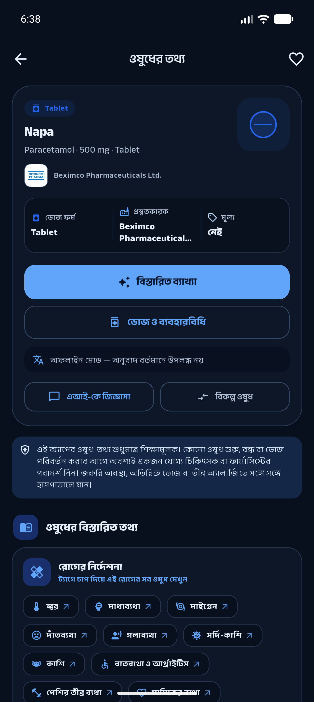</a><br><strong>ওষুধের বিবরণ</strong></td>
  </tr>
  <tr>
    <td align="center"><a href="docs/app/screenshots/learning.png"></a><br><strong>শেখা ও কোর্স</strong></td>
    <td align="center"><a href="docs/app/screenshots/learning-quiz.png">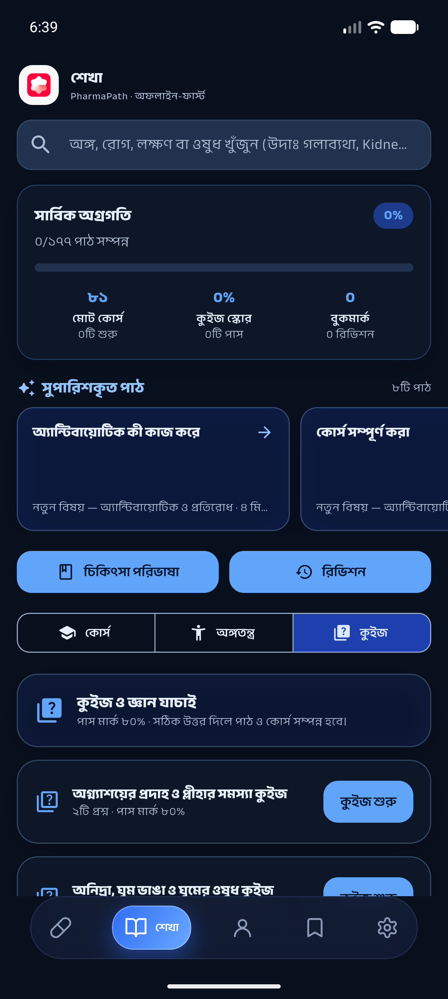</a><br><strong>কুইজ</strong></td>
    <td align="center"><a href="docs/app/screenshots/quiz-run.png">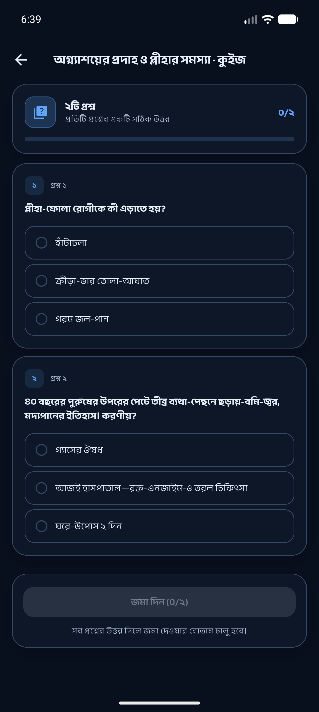</a><br><strong>কুইজের প্রশ্ন</strong></td>
  </tr>
  <tr>
    <td align="center"><a href="docs/app/screenshots/patient.png">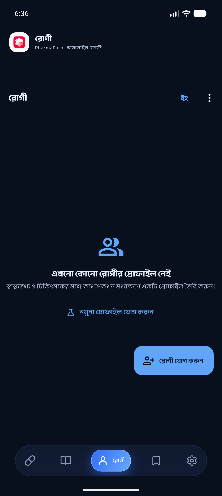</a><br><strong>রোগী ব্যবস্থাপনা</strong></td>
    <td align="center"><a href="docs/app/screenshots/favorites.png">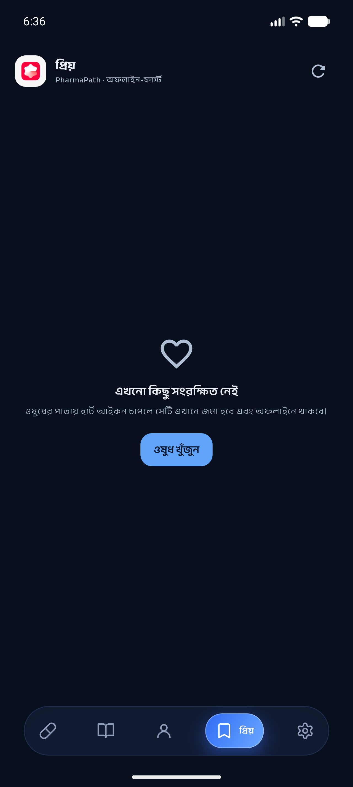</a><br><strong>প্রিয়</strong></td>
    <td align="center"><a href="docs/app/screenshots/settings.png"></a><br><strong>সেটিংস</strong></td>
  </tr>
</table>

<details>
  <summary><strong>সেটিংস ও ডেটা ব্যবস্থাপনার আরও স্ক্রিনশট</strong></summary>
  <br>
  <table>
    <tr>
      <td align="center"><a href="docs/app/screenshots/appearance.png">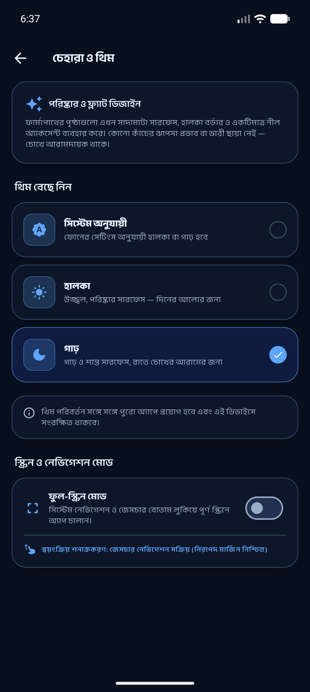</a><br><strong>চেহারা ও থিম</strong></td>
      <td align="center"><a href="docs/app/screenshots/offline-data.png">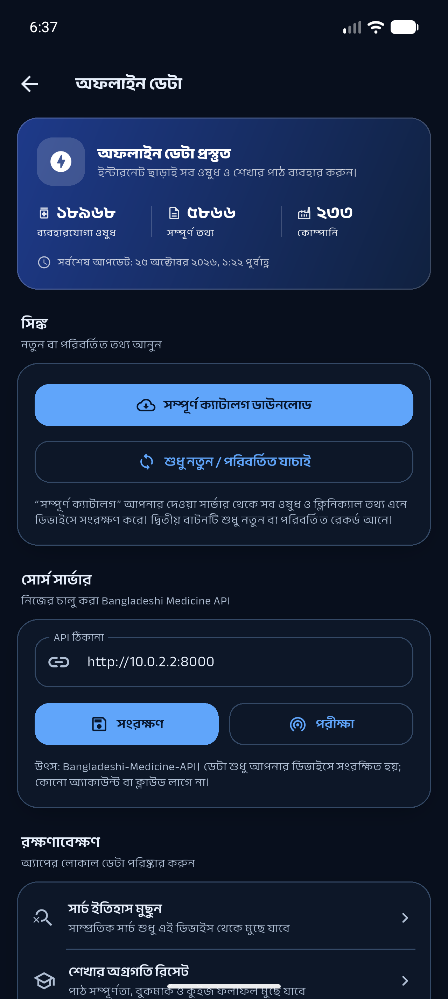</a><br><strong>অফলাইন ডেটা ও সিঙ্ক</strong></td>
      <td align="center"><a href="docs/app/screenshots/backup.png">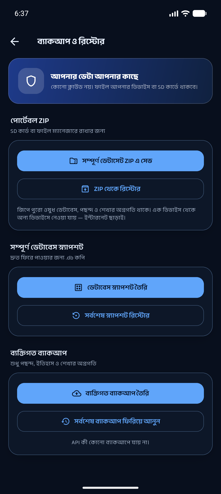</a><br><strong>ব্যাকআপ ও রিস্টোর</strong></td>
    </tr>
    <tr>
      <td align="center"><a href="docs/app/screenshots/medical-safety.png">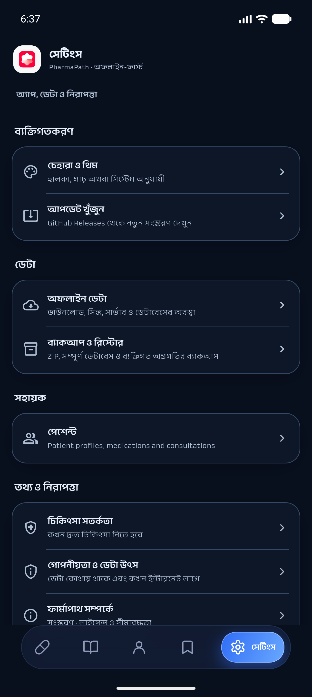</a><br><strong>চিকিৎসা সতর্কতা</strong></td>
      <td align="center"><a href="docs/app/screenshots/privacy.png">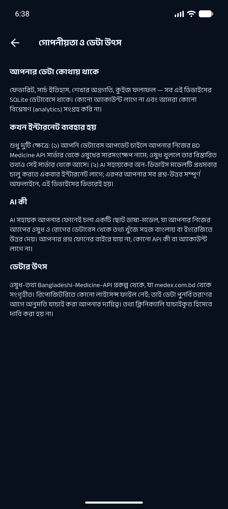</a><br><strong>গোপনীয়তা ও ডেটা উৎস</strong></td>
      <td align="center"><a href="docs/app/screenshots/about.png">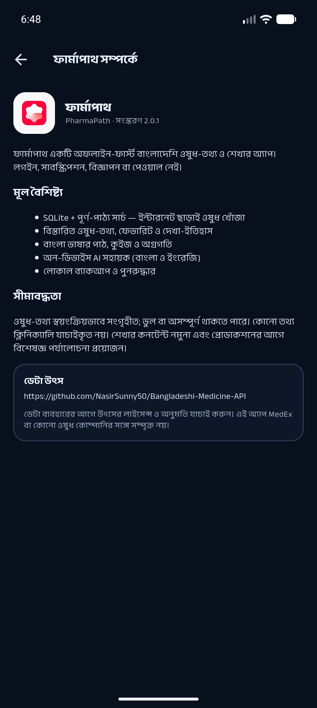</a><br><strong>অ্যাপ সম্পর্কে</strong></td>
    </tr>
  </table>
</details>

## ডাউনলোড ও আপডেট

**বর্তমান সংস্করণ: 2.0.1** · [সর্বশেষ GitHub Release থেকে APK নিন](https://github.com/shahinrezasifat/pharmapath-app/releases/latest)

অ্যাপ চালু হলেই ইন্টারনেট দিয়ে GitHub-এর সর্বশেষ প্রকাশিত সংস্করণ যাচাই হয়। নতুন সংস্করণ থাকলে আপডেটের পর্দা আসবে এবং আপডেট ইনস্টল না করা পর্যন্ত অ্যাপের বাকি অংশে যাওয়া যাবে না। অ্যাপ থেকেই APK ডাউনলোড শুরু হয়; Android-এর ইনস্টলার শেষে ইনস্টল নিশ্চিত করতে বলবে। আপডেট যাচাই করতে ইন্টারনেট লাগবে।

## গোপনীয়তা ও ডেটা

- প্রোফাইল, পছন্দের ওষুধ, সার্চ ইতিহাস এবং শেখার অগ্রগতি ডিভাইসেই থাকে।
- অ্যাপ অ্যাকাউন্ট বা অ্যানালিটিক্স প্রোফাইল নেই।
- অনলাইন সংযোগ লাগে ক্যাটালগ সিঙ্ক, ঐচ্ছিক AI মডেলের প্রথম ব্যবহার এবং GitHub আপডেট যাচাইয়ের জন্য।
- ওষুধের ডেটার উৎস ও সীমাবদ্ধতা অ্যাপের **সেটিংস → গোপনীয়তা ও ডেটা উৎস**-এ ব্যাখ্যা করা আছে। PharmaPath কোনো ওষুধ কোম্পানির সঙ্গে সম্পৃক্ত নয়।

## ডেভেলপারদের জন্য

```powershell
flutter pub get
flutter build apk --release `
  --dart-define=GITHUB_REPOSITORY_OWNER=shahinrezasifat `
  --dart-define=GITHUB_REPOSITORY_NAME=pharmapath-app
```

APK তৈরি হবে `build/app/outputs/flutter-apk/app-release.apk`-এ। Android-এর ইন-প্লেস আপডেটের জন্য একই application ID এবং release signing key ধরে রাখুন। ভবিষ্যৎ GitHub Release-এ `pubspec.yaml`-এর version বাড়িয়ে APK যুক্ত করুন। স্বয়ংক্রিয় release workflow ব্যবহার করলে repository Actions-এ `ANDROID_KEYSTORE_BASE64` ও `ANDROID_KEY_PROPERTIES` secrets সেট করুন; signing key কখনো repository-তে commit করবেন না।

**প্ল্যাটফর্ম:** Android · **Application ID:** `com.pharmapath.pharmapath_app` · **লাইসেন্স:** repository-তে উল্লেখিত প্রকল্পের লাইসেন্স ও তৃতীয় পক্ষের ডেটা-লাইসেন্স যাচাই করুন।
